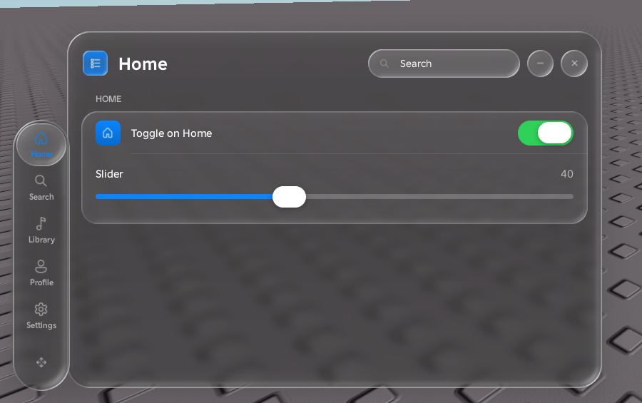
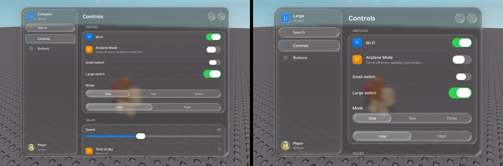
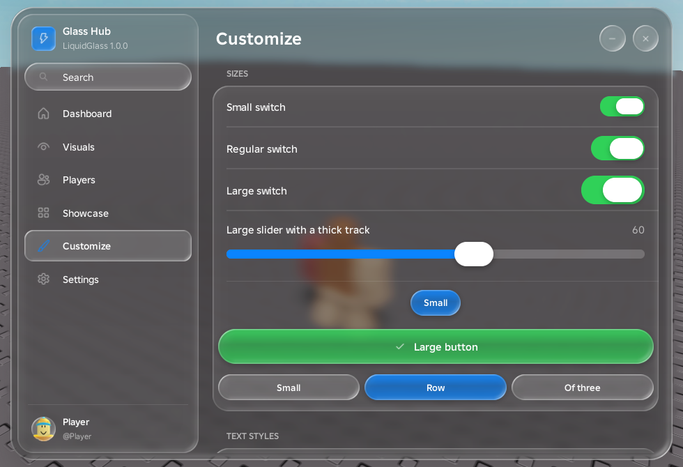

# LiquidGlass documentation

- [Loading](#loading)
- [Windows](#windows)
- [Navigation: sidebar or tab bar](#navigation-sidebar-or-tab-bar)
- [Tabs and sections](#tabs-and-sections)
- [Elements](#elements)
  - [Options every element understands](#options-every-element-understands)
  - [Methods every element has](#methods-every-element-has)
  - [Button](#button) · [Buttons](#buttons) · [Toggle](#toggle) · [Slider](#slider) · [Dropdown](#dropdown) · [Input](#input) · [Keybind](#keybind) · [Color picker](#color-picker) · [Segmented control](#segmented-control) · [Stepper](#stepper) · [Progress](#progress) · [Label](#label) · [Paragraph](#paragraph) · [Code](#code) · [Image](#image) · [Divider and spacer](#divider-and-spacer) · [Custom content](#custom-content)
- [Customizing sizes](#customizing-sizes)
  - [Density](#density) · [Per-element sizes](#per-element-sizes) · [Text styling](#text-styling) · [Metrics](#metrics) · [Fonts](#fonts) · [Scale](#scale)
- [Themes and colors](#themes-and-colors)
- [Images and icons](#images-and-icons)
- [Notifications](#notifications)
- [Dialogs](#dialogs)
- [Context menus](#context-menus)
- [Configs](#configs)
- [Settings tab](#settings-tab)
- [Global API](#global-api)
- [The intro](#the-intro)
- [Rayfield and Fluent compatibility](#rayfield-and-fluent-compatibility)
- [Building from source](#building-from-source)

---

## Loading

```lua
local LiquidGlass = loadstring(game:HttpGet("https://raw.githubusercontent.com/fischgesichtert/LiquidGlass/main/dist/LiquidGlass.lua"))()
```

Running the script a second time replaces the previous copy completely. That removes its windows, blur, sounds and connections.

The first time it runs, the library unpacks its textures, icons, sounds and the intro model into `LiquidGlass/assets/<version>/` in the executor workspace. After that it reuses those files.

---

## Windows

```lua
local Window = LiquidGlass:CreateWindow({
	Title = "My Script",
	Subtitle = "v1.0",
	Icon = "bolt",
	Size = Vector2.new(720, 500),
})
```

| Option | Default | Description |
|---|---|---|
| `Title` | `"LiquidGlass"` | Window title (alias `Name`). |
| `Subtitle` | – | Line under the title (alias `SubTitle`). |
| `Icon` | `"layers"` | Icon name or [any image](#images-and-icons) (aliases `Logo`, `Image`). |
| `Size` | `Vector2.new(700, 480)` | `Vector2`, `UDim2` or `{w, h}`. Clamped to the screen. |
| `MinSize` | `Vector2.new(480, 340)` | Smallest size the window can be resized to. |
| `Position` | centered | `Vector2` or `UDim2`. New windows cascade so they never open exactly on top of each other. |
| `Resizable` | `true` | Resize by dragging the right edge, the bottom edge or the bottom-right corner. |
| `Navigation` | `"Sidebar"` | `"Sidebar"` or `"TabBar"`, see [Navigation](#navigation-sidebar-or-tab-bar). |
| `TabBar` | – | Tab bar options; see [Navigation](#navigation-sidebar-or-tab-bar). |
| `ToggleKey` | `RightControl` | Key that hides and shows every window (aliases `MinimizeKey`, `Keybind`). |
| `Theme` | `"Dark"` | `"Dark"`, `"Light"`, or a theme table or name. |
| `Accent` | system blue | `Color3` or hex string such as `"#FF2D55"`. |
| `Density` | `"Regular"` | `"Compact"`, `"Regular"` or `"Large"`, see [Density](#density). |
| `Metrics` | – | A table of metric overrides, see [Metrics](#metrics). |
| `Font` | Builder Sans | Interface font, see [Fonts](#fonts). |
| `Scale` | `1` | Scale for the whole interface. |
| `Search` | `true` | Search field that filters the rows of the current tab. |
| `Profile` | `true` | Avatar footer in the sidebar. |
| `ConfirmClose` | `true` | The close button asks whether to *Hide* or *Unload*. With `false` it unloads immediately. |
| `Sounds` / `Blur` | `true` | Turn interface sounds or background blur off. |
| `IntroTitle` | window title | Text shown under "Entity" in the intro. |
| `ConfigurationSaving` | – | Rayfield-style automatic configs, see [Configs](#configs). |
| `OnTabChanged(tab)` | – | Called whenever the selected tab changes. |
| `OnDestroy()` | – | Called when the window is destroyed. |

Ways to interact with a window:

- Drag it by its header (or the sidebar brand).
- Resize it from the edges.
- Click minimize to turn it into a glass pill at the top of the screen. Tap the pill to restore the window, or drag the pill out of the way.
- On touch devices a floating glass button also toggles the window.
- When the window is narrower than 600 px, the sidebar collapses to icons.

### Window methods

| Method | Description |
|---|---|
| `Window:AddTab(options)` | Adds a tab, see [Tabs](#tabs-and-sections) (alias `CreateTab`). |
| `Window:SelectTab(tab or index)` | Switches to a tab. |
| `Window:AddSettingsTab(options?)` | Adds a ready-made [settings tab](#settings-tab). |
| `Window:SetTitle(text)` / `SetSubtitle(text)` | Changes the title or subtitle. |
| `Window:SetSize(Vector2)` | Resizes with an animation. |
| `Window:Center()` | Glides the window back to the center. |
| `Window:SetResizable(bool)` | Turns resizing on or off. |
| `Window:SetVisible(bool)` / `Toggle()` / `IsVisible()` | Shows or hides the window (the glass dissolves into the background). |
| `Window:Minimize()` / `Restore()` | Turns the window into the pill and back. With a tab bar that stays on screen, the bar takes the place of the pill. |
| `Window:Notify(options)` / `Dialog(options)` | Same as the [library versions](#notifications); the dialog is centered on this window. |
| `Window:Destroy()` | Removes the window. |
| Tab bar methods | See [Navigation](#navigation-sidebar-or-tab-bar). |

---

## Navigation: sidebar or tab bar

### Sidebar (default)

The sidebar shows the app icon, title, search, the tab list and the player profile. Tap a tab or drag the glass selection across the tabs. When the window gets narrow, the sidebar collapses to icons.

### Tab bar

```lua
local Window = LiquidGlass:CreateWindow({
	Title = "Music",
	Icon = "music",
	Navigation = "TabBar",
	TabBar = {
		Position = "Bottom",   -- "Bottom" | "Left" | "Top" | "Right"
		Floating = false,      -- true: detached, floats next to the window
		Screen = false,        -- true: pinned to the edge of the screen, like a dock
		Align = "Center",      -- pinned bars: "Start" (left / top), "Center", "End" (right / bottom)
		Locked = false,        -- true: no grip, the user can't move the bar
		HideWithWindow = false, -- true: a detached bar hides when the window hides
		Labels = true,         -- text under the icons (false: icon-only round buttons)
		Draggable = true,      -- the grip can move the bar
		Grip = true,           -- show the grip (tap: next edge, drag: move)
		Cycle = { "Bottom", "Left", "Top", "Right" }, -- edges the grip taps through
		Gap = 12,              -- distance between the bar and its window
		OnMoved = function(position, floating, screen, align) end, -- position is "Free" when dropped loose
	},
})
```

| Bar position | Behavior |
|---|---|
| Docked (default) | The bar sits inside the window on the chosen edge. The page content makes room for it. |
| Floating (`Floating = true`) | The bar is a separate piece of glass outside the window. It trails the window like liquid when the window moves. |
| Pinned to the screen (`Screen = true`) | The bar sits on an edge of the screen like a dock, and the window opens right next to it. |

A pinned bar can sit at the start, center or end of its edge, so it also fits into every **corner**, either lying along one edge or standing along the other. `Position` picks the edge, and with it the direction; `Align` picks the spot on that edge:

```lua
TabBar = { Screen = true, Position = "Bottom", Align = "Left" }  -- bottom-left corner, lying down
TabBar = { Screen = true, Position = "Left", Align = "Bottom" }  -- bottom-left corner, standing up
TabBar = { Screen = true, Position = "Right", Align = "Top" }    -- top-right corner, standing up
```



`Align` accepts `"Start"`, `"Center"` and `"End"`, or the plain directions `"Left"`, `"Top"` (= Start) and `"Right"`, `"Bottom"` (= End). A bar pinned to the middle of the bottom edge moves up above the Roblox backpack hotbar while the player has tools, and a bar at the top stays clear of the Roblox top bar.

**The bar stays on screen.** A detached or pinned bar stays visible when the window is hidden (toggle key, close → Hide) or minimized. Tapping any of its tabs brings the window back. Set `HideWithWindow = true` to hide it together with the window instead, or call `Window:SetTabBarVisible(false)` to hide it yourself. A docked bar is part of the window, so it always hides with it.

**The window comes to the bar.** When the bar is pinned to the screen (or dropped loose somewhere), tapping a tab opens the window right next to it, lined up with the bar:

- above a bar at the bottom
- below a bar at the top
- beside a bar on the left or right

The window then moves along whenever the bar moves. If you drag the window away, it stays where you put it until you tap a tab again.

Add `Locked = true` to fix the bar in place: the grip disappears, and neither dragging nor tapping can move it. Your script can still move it with the methods below.

The grip at the end of the bar moves it:

- **Tap** moves the bar to the next edge in `Cycle`.
- **Drag** the bar close to an edge of the screen to pin it there. While you drag, a glass outline shows the exact spot and direction it will snap to, and the bar leans into that spot like a magnet. If the bar is about to turn from lying to standing (or back), it shrinks a little toward the outline. The screen edges push back softly instead of letting the bar slide off screen.
- Drag a docked bar **out of the window** to detach it. If you drop it far away, it stays exactly where you dropped it.
- Drop a floating bar **onto the window** to dock it inside again.

Selecting tabs works like the sidebar: tap a tab, or drag the glass lens across the bar. If the bar runs out of space, its items shrink to fit and the labels hide when items get too narrow.

| Method | Description |
|---|---|
| `Window:SetTabBarPosition(position, floating?)` | Moves the bar with an animation. Pass `floating` to also detach or attach it. |
| `Window:SetTabBar(options)` | Changes any of the options above at runtime. |
| `Window:DetachTabBar()` / `Window:AttachTabBar()` | Floats the bar next to the window, or docks it back inside. |
| `Window:PinTabBar(edge?, align?)` | Pins the bar to an edge of the screen (`"Bottom"`, `"Left"`, `"Top"` or `"Right"`; default: its current edge), at `align` along it. |
| `Window:UnpinTabBar()` | Lets a pinned bar float next to the window again. |
| `Window:LockTabBar(locked?)` | Locks the bar in place (`true`, the default) or unlocks it (`false`). |
| `Window:SetTabBarVisible(visible)` | Hides (`false`) or shows (`true`) the bar itself. |
| `Window:GetTabBar()` | The bar object (`.Position`, `.Align`, `.Floating`, `.Screen`, `.Locked`, `.Root`). |

`Window:AddSettingsTab()` adds tab bar controls automatically for tab bar windows: position, detached, pin to screen edge, alignment along the edge, lock position, hide with window and labels.

---

## Tabs and sections

```lua
local Tab = Window:AddTab({ Title = "Visuals", Icon = "eye" })   -- or Window:AddTab("Visuals", "eye")
local Section = Tab:AddSection("ESP")                           -- or { Title = "ESP" }; no title: plain card
```

You can call every `Add…` element method on a tab directly. The element goes into the tab's most recent section, and the tab creates an untitled section if it has none yet.

| Tab | Description |
|---|---|
| `Tab:AddSection(title or options)` | Adds a card. |
| `Tab:Select()` | Switches the window to this tab. |
| `Tab:SetTitle(text)` / `SetIcon(icon)` | Changes the tab's title or icon. |

| Section | Description |
|---|---|
| `Section:SetTitle(text)` | Changes the header (alias `Set`). |
| `Section:SetVisible(bool)` | Shows or hides the section. |
| `Section:Destroy()` | Removes the section. |

---

## Elements

### Options every element understands

| Option | Aliases | Description |
|---|---|---|
| `Title` | `Name`, `Text` | Row title. |
| `Description` | `Desc`, `SubText` | Second line under the title. |
| `Icon` | `Image` | Icon at the start of the row. |
| `IconColor` | `BadgeColor` | Draws the icon on a colored badge, like iOS Settings. Takes a `Color3` or a theme token (`"Accent"`, `"Danger"`…). |
| `Flag` | `Id`, `Idx` | Registers the element in `LiquidGlass.Options[flag]` and saves it in [configs](#configs). |
| `Callback` | `Func`, `Function` | Called with the new value. |
| `Tooltip` | `Hint` | Tooltip shown after hovering for a moment. |
| `Disabled` | `Locked` | Dims the element and blocks its input. |
| `Visible` | | `false` starts the element hidden. |
| `RowHeight` | | Minimum row height in px. |
| `TitleSize`, `DescriptionSize` | `TextSize`, `DescSize` | Text sizes. |
| `TitleColor`, `DescriptionColor` | `DescColor` | `Color3` or theme token. |
| `TitleWeight`, `DescriptionWeight` | `Weight` | `Enum.FontWeight` or its name (`"Bold"`). |
| `Font` | `FontFace`, `FontFamily` | A font for this element, see [Fonts](#fonts). |

Elements also accept the Fluent call style `Tab:AddToggle("Flag", { ... })`, and the short form `Section:AddButton("Title", callback)`.

### Methods every element has

| Method | Description |
|---|---|
| `:SetTitle(text)` / `:SetDescription(text)` | Changes the row text. |
| `:SetTooltip(text)` | Changes the tooltip. |
| `:SetVisible(bool)` | Shows or hides the element. |
| `:SetDisabled(bool)` / `:Lock()` / `:Unlock()` | Disables or enables the element. |
| `:OnChanged(fn)` | Listens to value changes. Runs once right away with the current value, and returns `{ Disconnect = fn }`. |
| `:Destroy()` | Removes the element. |
| `:Set(value, silent)` / `:SetValue(...)` | Elements with a value: `silent = true` skips the callback. |
| `:Get()` / `:GetValue()` / `.Value` | Current value. `.CurrentValue`, `.CurrentOption` and `.CurrentKeybind` also work, for Rayfield scripts. |

Callbacks run on their own thread. A callback that errors only prints a warning and never breaks the interface.

### Button

```lua
Section:AddButton({ Title = "Rejoin", Description = "Reconnects to this server", Icon = "refresh", IconColor = Color3.fromRGB(142, 142, 147), Callback = function() end })
Section:AddButton({ Title = "Buy", Style = "Primary", Icon = "cart" })
Section:AddButton({ Title = "Small", Size = "Small", Width = "Auto", Align = "Left" })
```

| Option | Description |
|---|---|
| `Style` | No style: a list row with a chevron. `"Primary"`, `"Glass"`, `"Success"`, `"Destructive"` give a glass capsule. |
| `Size` | Capsule size: `"Small"`, `"Regular"` or `"Large"`. |
| `Width` | `"Fill"` (default), `"Auto"` (hugs the label) or a number of px. |
| `Align` | `"Left"`, `"Center"` or `"Right"`, for capsules that don't fill the row. |
| `Accessory` | Text on the right of a row button (alias `Value`). |
| `Destructive` | Shows the title in red. |
| `Color` | Title color of a row button. |

Methods: `:Fire()` runs the callback, `:SetAccessory(text)` changes the accessory text.

### Buttons

A row of capsules that share the width equally.

```lua
Section:AddButtons({
	{ Title = "Save", Style = "Primary", Icon = "save", Callback = save },
	{ Title = "Load", Icon = "download", Callback = load },
	{ Title = "Delete", Style = "Destructive", Size = "Small" },
}, { Size = "Regular" })
```

### Toggle

```lua
local t = Section:AddToggle({ Title = "Fly", Default = false, Flag = "fly", Size = "Large", Callback = function(on) end })
t:Toggle()
```

Tap the row or the switch, or drag the knob. The knob turns into a glass lens while you hold it.

| Option | Description |
|---|---|
| `Default` | Starting value (aliases `Value`, `CurrentValue`, `State`). |
| `Size` | `"Small"`, `"Regular"`, `"Large"` or a number factor. |

Methods: `:Set(bool, silent)`, `:Toggle()`.

### Slider

```lua
Section:AddSlider({ Title = "Speed", Min = 16, Max = 200, Default = 16, Step = 1, Suffix = " studs/s", Callback = function(v) end })
```

| Option | Description |
|---|---|
| `Min`, `Max` | Range (or `Range = { min, max }`). |
| `Step` | Snapping (aliases `Increment`, `Interval`), or `Rounding` for a number of decimals. |
| `Default` | Starting value. |
| `Prefix`, `Suffix` | Text around the value. |
| `Released(v)` | Called when the user lets go (aliases `OnRelease`, `ChangedCallback`). |
| `Size` | Knob size: `"Small"`, `"Regular"`, `"Large"` or a number factor. |
| `TrackHeight` | Track thickness in px. |

Click the value to type an exact number. Methods: `:Set(n, silent)`, `:SetRange(min, max)`, `:SetMin(n)`, `:SetMax(n)`.

### Dropdown

```lua
Section:AddDropdown({ Title = "Weapon", Options = { "Sword", "Bow" }, Default = "Sword", Callback = function(v) end })
Section:AddDropdown({ Title = "Targets", Options = { "Players", "NPCs" }, Multi = true, Default = { "Players" } })
```

| Option | Description |
|---|---|
| `Options` | Values of any type (aliases `Values`, `List`, `Items`). |
| `Default` | A value, a list for multi, Fluent's index, or a `{ value = true }` set. |
| `Multi` | Multi-select with checkmarks (aliases `MultipleOptions`, `Multiple`). |
| `Searchable` | Search field in the menu. On by default with more than 8 options. |
| `AllowNull` | Tapping the selected option clears it. |
| `Placeholder` | Text shown while nothing is selected. |
| `Width` | Width of the value column in px. |

`.Value` is the selected option, or a list when `Multi` is on. Methods: `:Set(v)`, `:SetOptions(list, keepSelection)`, `:Refresh(list)`, `:Add(v)`, `:Remove(v)`, `:Clear()`.

### Input

```lua
Section:AddInput({ Title = "Name", Placeholder = "Type", Callback = function(text) end })
Section:AddInput({ Title = "Notes", Multiline = true, Height = 100 })
```

| Option | Description |
|---|---|
| `Default` | Starting text. |
| `Placeholder` | Hint shown while the field is empty. |
| `Numeric` | Only numbers; the callback gets a number. |
| `MaxLength` | Character limit. |
| `Multiline` | A text area under the title; `Height` sets its height. |
| `Width` | Field width in px. |
| `Finished` | `true`: the callback runs only when you press Enter. `false`: it runs on every keystroke. Unset: it runs when the field loses focus. |
| `Changed(text)` | Runs on every keystroke. |
| `ClearOnFocus` | Clears the text when the field is focused. |
| `RemoveTextAfterFocusLost` | Clears the text after the callback has run. |

Methods: `:Set(text)`, `:Focus()`, `:SetPlaceholder(text)`.

### Keybind

```lua
Section:AddKeybind({ Title = "Fly", Default = Enum.KeyCode.F, Mode = "Toggle", Callback = function(state) end })
```

| Option | Description |
|---|---|
| `Default` | `KeyCode`, a key name such as `"Q"`, or a mouse button: `"MB2"` or `Enum.UserInputType.MouseButton2`. |
| `Mode` | `"Toggle"`, `"Hold"` (`true` while held, `false` on release) or `"Always"`. |
| `ChangedCallback(key)` | Runs when the user binds a different key. |

Click the row and press a key to rebind. Escape cancels, Backspace clears. Methods: `:Set(key)`, `:GetState()`, `:OnClick(fn)`, `:SetMode(mode)`.

### Color picker

```lua
Section:AddColorPicker({ Title = "ESP color", Default = Color3.fromRGB(255, 45, 85), Transparency = 0.3, Callback = function(color, transparency) end })
```

The picker has a saturation/brightness field, a hue bar, an alpha bar (when `Transparency` is set), hex entry and presets. Methods: `:Set(color or hex, transparency?)`. `.Value` is the `Color3`, `.Transparency` the alpha.

### Segmented control

```lua
Section:AddSegmented({ Title = "Mode", Options = { "Legit", "Rage" }, Default = "Legit", Callback = function(v) end })
```

Tap a segment, or drag the glass lens across the segments. With no title, the control fills the row.

### Stepper

```lua
Section:AddStepper({ Title = "Amount", Min = 1, Max = 10, Step = 1, Default = 3, Callback = function(v) end })
```

### Progress

```lua
local p = Section:AddProgress({ Title = "Download", Default = 0.4 }) -- 0..Max (default 1); Suffix shows the raw value
p:Set(0.8)
```

### Label

```lua
Section:AddLabel("Plain text")
Section:AddLabel({ Title = "Styled", TitleColor = "Accent", TitleWeight = "Bold" })
```

### Paragraph

```lua
local para = Section:AddParagraph({ Title = "About", Content = "Longer text that wraps." })
para:Set({ Title = "New title", Content = "New text" })
```

### Code

```lua
Section:AddCode({ Title = "Join script", Code = "game:GetService('TeleportService'):Teleport(123)" })
```

A monospace block with a copy button.

### Image

```lua
Section:AddImage({ Image = "rbxthumb://type=GameIcon&id=" .. game.GameId .. "&w=512&h=512", Height = 160, Caption = "Game icon" })
```

| Option | Description |
|---|---|
| `Image` | [Any image source](#images-and-icons). |
| `Height` | Height in px. |
| `AspectRatio` | Width / height; overrides `Height`. |
| `ScaleType` | `"Crop"` (default), `"Fit"` or `"Stretch"`. |
| `Caption` | Text under the image. |
| `Callback` | Makes the image clickable. |

Methods: `:Set(image)`, `:SetHeight(px)`.

### Divider and spacer

```lua
Section:AddDivider()
Section:AddSpacer(16)
```

### Custom content

Put your own instances inside a card:

```lua
Section:AddCustom({ Title = "Chart", Height = 120, Build = function(frame, element, LiquidGlass)
	local bar = Instance.new("Frame")
	bar.Size = UDim2.new(0.6, 0, 0, 20)
	bar.Parent = frame
end })
```

---

## Customizing sizes

Every size in LiquidGlass comes from one balanced set of metrics. Spacing sits on a 4 px grid, there is one type ramp, and nested corners are concentric. You can change that set as a whole, per element, or one value at a time.

### Density

```lua
LiquidGlass:CreateWindow({ Title = "Hub", Density = "Compact" }) -- "Compact" | "Regular" | "Large"
-- or before creating windows:
LiquidGlass:SetDensity("Large")
```



Each density is a complete, tested set of sizes. Rows, controls, text, icons, radii, the tab bar, notifications and dialogs all change together, so the proportions stay right.

### Per-element sizes

| Element | Options |
|---|---|
| Toggle | `Size = "Small" \| "Regular" \| "Large"` or a number factor |
| Slider | `Size` (knob), `TrackHeight` |
| Button (capsule) | `Size`, `Width = "Fill" \| "Auto" \| px`, `Align` |
| Buttons row | `AddButtons(list, { Size = ... })`, or `Size` on each button |
| Input | `Width`, `Height` (multiline) |
| Dropdown | `Width` (value column) |
| Image | `Height`, `AspectRatio` |
| Any row | `RowHeight` |



### Text styling

Every element takes `TitleSize`, `TitleColor`, `TitleWeight`, `DescriptionSize`, `DescriptionColor`, `DescriptionWeight` and `Font`, see [Options every element understands](#options-every-element-understands).

### Metrics

Change any single value before creating windows. The values that depend on it are recomputed:

```lua
LiquidGlass:SetMetrics({ Body = 16, RowMin = 52, Button = 40, WindowRadius = 30 })
LiquidGlass:ResetMetrics()
print(LiquidGlass.Metrics.RowMin)
```

| Group | Keys (Regular values) |
|---|---|
| Type | `LargeTitle` 24, `Title` 17, `Body` 15, `Callout` 14, `Subhead` 13, `Footnote` 12, `Caption` 11 |
| Window | `WindowRadius` 26, `WindowInset` 8, `Gutter` 16, `Header` 56 |
| Sidebar | `Sidebar` 208, `TabRow` 36, `TabGap` 2, `IconAxis` 30, `TextAxis` 52 |
| Lists | `CardRadius` 18, `RowInset` 16, `RowPadY` 12, `RowMin` 48, `RowGap` 3, `Badge` 28, `BadgeRadius` 7, `BadgeIcon` 16, `RowIcon` 20, `IconGap` 12, `HighlightInset` 4, `SectionGap` 20, `HeaderGap` 6 |
| Controls | `Control` 30, `Field` 170, `Segmented` 32, `Chevron` 12, `SwitchW` 62, `SwitchH` 28, `KnobW` 38, `KnobH` 24, `Button` 36, `ButtonSmall` 30, `ButtonLarge` 40, `IconButton` 30 |
| Overlays | `PopoverRadius` 20, `MenuInset` 6, `MenuItem` 38, `Notify` 340, `NotifyRadius` 22, `NotifyPad` 14, `NotifyBadge` 36, `DialogW` 300, `DialogRadius` 26, `DialogPad` 20 |
| Tab bar | `TabBarItem` 74, `TabBarHeight` 56, `TabBarInset` 4, `TabBarGap` 12 |

### Fonts

```lua
LiquidGlass:SetFont(Enum.Font.Gotham)        -- or a Font, "Gotham", or "rbxasset://fonts/families/....json"
LiquidGlass:CreateWindow({ Font = "Montserrat" })
Section:AddToggle({ Title = "Mono", Font = Enum.Font.RobotoMono })
```

`SetFont` affects everything created afterwards.

### Scale

```lua
LiquidGlass:SetScale(1.2) -- 0.4 – 2, keeps windows on screen; also in the settings tab
```

---

## Themes and colors

```lua
LiquidGlass:SetTheme("Light")                   -- "Dark" | "Light" | a theme table
LiquidGlass:SetAccent(Color3.fromRGB(255, 45, 85)) -- or "#FF2D55"
LiquidGlass:SetThemeValue("GlassT", 0.8)        -- change single values live
LiquidGlass:SetThemeValue({ Accent = Color3.fromRGB(48, 209, 88), Switch = Color3.fromRGB(10, 132, 255) })
local custom = LiquidGlass:AddTheme("Midnight", "Dark", { DimT = 0.35, Text = Color3.fromRGB(230, 230, 255) })
LiquidGlass:SetTheme("Midnight")
```

Theme changes animate live on every element that already exists.

| Token | Meaning |
|---|---|
| `Text`, `Text2T`, `Text3T` | Text color and the transparency of secondary and tertiary text. |
| `Glass`, `GlassT` | Tint of floating surfaces. |
| `Dim`, `DimT` | Darkening behind the tint, which keeps text readable. |
| `DenseDimT`, `StackDimT` | The same darkening, stronger, for overlays and for windows on top of windows. |
| `Card`, `CardT`, `CardRim` | Section cards. |
| `Control`, `ControlT`, `ControlRim` | Fields, glass buttons, pills. |
| `Track`, `TrackT` | Slider and switch tracks. |
| `Separator`, `SeparatorT` | Row separators. |
| `Highlight`, `HighlightT`, `PressT` | Row hover and press. |
| `Accent`, `Switch`, `Success`, `Warning`, `Danger`, `OnAccent` | Colors. |
| `Overlay`, `OverlayT`, `Field`, `FieldT`, `Shadow`, `Rim`, `Knob` | Dialog shade, code block background, shadows, rim light and knobs. |

---

## Images and icons

Anywhere an image is accepted (element icons, `AddImage`, window icons, notifications, tab icons), you can use any of these:

- An **icon name** from the built-in atlas. `LiquidGlass.Icons` lists all 165, and common Lucide/Feather names work as aliases. Unknown names print a warning.
- An **asset id**: `4483362458` or `"rbxassetid://4483362458"`.
- **Thumbnails**: `"rbxthumb://type=GameIcon&id=...&w=512&h=512"`, or `LiquidGlass:Avatar(userId, "AvatarHeadShot" | "AvatarBust")`.
- **Web URLs** (`https://...png`). They are downloaded once and cached in `LiquidGlass/cache`.
- **Local files** in the executor workspace.

Icons take the text color. Pictures keep their own colors.

---

## Notifications

```lua
local n = LiquidGlass:Notify({
	Title = "Saved",
	Content = "Your config was saved.",
	SubContent = "just now",
	Type = "Success",        -- Info | Success | Warning | Error
	Duration = 5,            -- 0 keeps it open until dismissed
	Icon = "save",           -- or Image = any image source
	Actions = { { Title = "Undo", Callback = undo }, { Title = "OK" } },
	OnClick = function() end,
})
n.Close()
```

Hovering a notification pauses its timer, swiping it right dismisses it, and a tap runs `OnClick`. `LiquidGlass.NotifyPosition` sets where notifications appear: `"TopRight"`, `"TopLeft"`, `"TopCenter"`, `"BottomRight"` or `"BottomLeft"`. Notifications sent during the intro appear right after it.

## Dialogs

```lua
Window:Dialog({
	Title = "Reset everything?",
	Content = "This cannot be undone.",
	Icon = "warning",
	IconColor = "Danger",
	Input = { Placeholder = "Type RESET" },  -- optional text field
	Buttons = {
		{ Title = "Cancel", Style = "Cancel" },
		{ Title = "Reset", Style = "Destructive", Callback = function(text) end },
	},
})
```

If a button callback returns `false`, the dialog stays open. Escape or a click on the shade cancels the dialog.

## Context menus

```lua
LiquidGlass:Menu(someGuiObject, {
	{ Title = "Copy", Callback = copy },
	{ Title = "Delete", Callback = delete },
})
```

---

## Configs

Every flagged toggle, slider, dropdown, input, keybind, color, segmented control and stepper is saved as JSON under `LiquidGlass/configs/<folder>/<name>.json`. The folder is the place id by default.

```lua
LiquidGlass:SetConfigFolder("MyHub")
LiquidGlass:SaveConfig("legit")          -- returns ok, err
LiquidGlass:LoadConfig("legit")
LiquidGlass:DeleteConfig("legit")
LiquidGlass:ListConfigs()                -- { "legit", ... }
LiquidGlass:SetAutoload("legit")
LiquidGlass:LoadAutoload()
```

Rayfield style also works:

```lua
LiquidGlass:CreateWindow({ ConfigurationSaving = { Enabled = true, FolderName = "MyHub", FileName = "config" } })
-- ... add elements with Flags ...
LiquidGlass:LoadConfiguration() -- restores the values, then saves changes automatically
```

Add `NoSave = true` to an element to keep it out of configs.

## Settings tab

`Window:AddSettingsTab({ Title = "Settings", Icon = "settings" })` adds a complete settings page:

- theme, accent color, background blur and interface scale
- tab bar position, detached and labels (tab bar windows only)
- interface sounds and volume
- the show/hide key and where notifications appear
- configs: save, load, delete and autoload
- unloading the interface

---

## Global API

| | |
|---|---|
| `LiquidGlass.Options[flag]` / `LiquidGlass.Flags[flag]` | Elements by flag. |
| `LiquidGlass.Windows` | Open windows. |
| `LiquidGlass.ToggleKey` | Key that shows and hides every window. |
| `LiquidGlass.NotifyPosition` | Where notifications appear. |
| `LiquidGlass.Settings.Sounds`, `.Volume` | Interface sounds on/off, and their volume (0 – 1). |
| `LiquidGlass:SetBlur(bool)` | Turns the background blur on or off. |
| `LiquidGlass:PlaySound(name)` | `hover`, `click`, `toggle_on`, `toggle_off`, `tick`, `open`, `close`, `notify`, `success`, `error`, `tab`, `popup`, `type` or `intro`. |
| `LiquidGlass.Icons` | All icon names. `LiquidGlass:GetIcon(name)` returns `{ Image, Offset, Size }`. |
| `LiquidGlass:Avatar(userId, kind)` | Avatar thumbnail URL. |
| `LiquidGlass.Metrics`, `.Densities`, `.Themes` | The live tables. |
| `LiquidGlass.OnUnload = function() end` | Runs when the interface unloads. |
| `LiquidGlass:Destroy()` / `:Unload()` / `:IsUnloaded()` | Removes everything: windows, blur glass, sounds and connections. |
| `LiquidGlass.Version` | Library version. |

---

## The intro

Before the first window opens, a short 3D intro plays. It shows the word **Entity**, made of real glass and built from exact font outlines, with "MADE BY" above it and your window title (or `IntroTitle`) below it. It floats in with a liquid settle over a softly moving color backdrop, a glint runs across its glass edges, and it dissolves into the interface with its own sound.

The intro lasts about 3 seconds, and the player can skip it with a click, Space or Enter. Without `EditableMesh` support, a 2D version plays instead.

---

## Rayfield and Fluent compatibility

Most Rayfield and Fluent scripts work unchanged once you load LiquidGlass instead. The supported calls include:

- **Rayfield:** `CreateWindow { Name, ConfigurationSaving }`, `CreateTab(name, image)`, `CreateSection`, `CreateButton`, `CreateToggle`, `CreateSlider { Range, Increment, Suffix }`, `CreateDropdown { CurrentOption, MultipleOptions }`, `CreateInput`, `CreateKeybind { HoldToInteract }`, `CreateColorPicker`, `CreateLabel`, `CreateParagraph`, `:Set()`, `Notify { Actions }` and `LoadConfiguration()`.
- **Fluent:** `AddTab { Title, Icon }`, `AddToggle("Flag", {...})`, `Options.X:SetValue()`, `:OnChanged()`, `AddDropdown { Values, Multi, Default = index }`, `AddColorpicker`, `AddKeybind { Mode }`, `AddInput { Numeric, Finished }`, `SelectTab(1)` and `Notify { SubContent }`.

---

## Building from source

The library is generated from `src/` (concatenated in file-name order) plus the assets that `tools/` produce:

- `tools/textures.py`: glass rims, shadows, glow, grip and checkerboard
- `tools/icons.py`: the icon atlas
- `tools/logo3d.py`: the 3D intro word
- `assets/sounds/`: the glass sounds

```bash
python build.py            # regenerate everything -> dist/LiquidGlass.lua
python build.py --install  # also copy it (and the demos) into the executor workspace
```

The build needs Python 3 with `numpy`, `Pillow`, `fonttools` and `mapbox_earcut`, plus Windows fonts for the icons and the intro word.

The tests in `tests/` drive the real interface through `VirtualInputManager`:

| Test | What it covers |
|---|---|
| `functional.lua` | Every element and window behavior. |
| `api.lua` | Rayfield and Fluent scripts, customization, the tab bar, hostile values and unloading. |
| `layout.lua` / `density.lua` | Alignment audit against the metrics at every density. |
| `monkey.lua` | Random input with invariant checks, for both navigation layouts. |

The tests only ever click visible LiquidGlass UI and only press keys no game uses. Set `getgenv().LiquidGlassSkipIntro = true` before running them.
