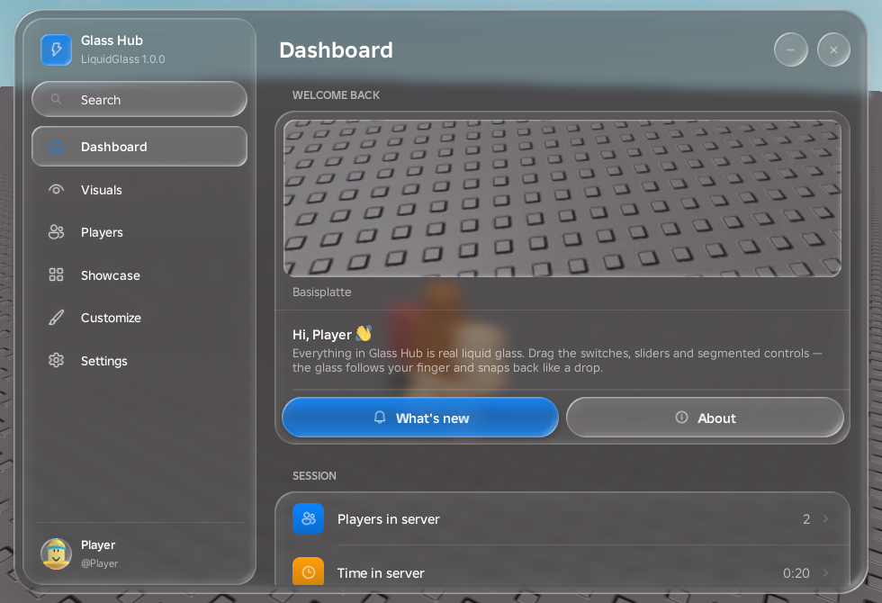
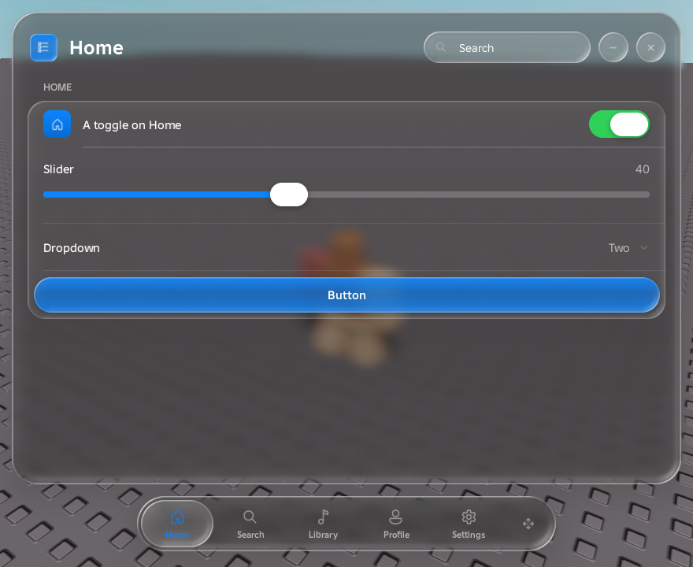

# LiquidGlass

**An iOS 26 "Liquid Glass" UI library for Roblox scripts.** Frosted glass that refracts the world behind it, lens-shaped edges, spring physics, glass sounds, and a 3D glass intro. It's one file and supports every kind of script.



## Features

- **Real glass.** Every surface is a lens-shaped piece of frosted glass. The world behind it gets blurred, and it bends around the edges. The glass never shows a sun glare.
- **Living controls.** Switches, sliders, segmented controls and tab selectors turn into a clear glass lens while you hold them. They follow your finger and snap back like a drop of water.
- **Everything included.** Toggles, sliders, dropdowns (single, multi, searchable), inputs, keybinds, color pickers with alpha, segmented controls, steppers, progress bars, buttons, labels, paragraphs, code blocks, images and custom content.
- **Two layouts.** A sidebar that collapses to icons, or an iOS tab bar. The tab bar can be docked on any edge, detached so it floats next to the window, pinned to any edge or corner of the screen like a dock (the window then opens right next to it), or dragged anywhere, with a snap preview and a magnetic feel. It can be locked in place.
- **Fully customizable.** Choose a density (Compact, Regular or Large), size each control on its own (Small, Regular or Large, or exact pixels), and set text size, color, weight and font per element. You can also change any single metric or theme color, add your own themes and accent colors, and scale the whole interface.
- **Images from anywhere.** 165 built-in icons, asset ids, avatar and game thumbnails, web URLs and local files.
- **Notifications, dialogs, menus and tooltips**, plus a ready-made settings tab and config save/load.
- **Glass sounds** for every interaction.
- **Works with Rayfield and Fluent scripts**, so existing code mostly runs unchanged.
- **Robust.** Callbacks that throw errors never break the UI, and loading the script again replaces the old copy cleanly. Every control works with mouse and touch.



## Quick start

```lua
local LiquidGlass = loadstring(game:HttpGet("https://raw.githubusercontent.com/fischgesichtert/LiquidGlass/main/dist/LiquidGlass.lua"))()

local Window = LiquidGlass:CreateWindow({
	Title = "My Script",
	Subtitle = "v1.0",
	Icon = "bolt",
})

local Main = Window:AddTab({ Title = "Main", Icon = "home" })
local Player = Main:AddSection("Player")

Player:AddToggle({ Title = "Infinite jump", Flag = "infJump", Callback = function(on)
	print("infinite jump", on)
end })

Player:AddSlider({ Title = "Walk speed", Min = 16, Max = 200, Default = 16, Callback = function(v)
	local h = game.Players.LocalPlayer.Character and game.Players.LocalPlayer.Character:FindFirstChildOfClass("Humanoid")
	if h then h.WalkSpeed = v end
end })

Player:AddButton({ Title = "Reset character", Style = "Primary", Callback = function()
	game.Players.LocalPlayer.Character:BreakJoints()
end })

Window:AddSettingsTab() -- theme, accent, blur, scale, sounds, keybind, configs

LiquidGlass:Notify({ Title = "Loaded", Content = "Press Right Ctrl to hide the window.", Type = "Success" })
```

Want a tab bar instead of the sidebar?

```lua
local Window = LiquidGlass:CreateWindow({
	Title = "Music",
	Navigation = "TabBar",
	TabBar = { Position = "Bottom", Floating = true }, -- Bottom | Left | Top | Right
})
```

Or use it as a dock on the edge of the screen. It stays visible, and its tabs open the window right next to it:

```lua
TabBar = { Screen = true, Position = "Left", Align = "Bottom" } -- standing in the bottom-left corner
```


## Documentation

[**DOCUMENTATION.md**](DOCUMENTATION.md) covers everything:

- windows and both navigation layouts
- every element and all of its options
- sizes, density, metrics, fonts and themes
- images, notifications, dialogs and configs
- the intro, and building the library from source

Two demos come with it:

- [`demo.lua`](demo.lua) is a complete script hub with a dashboard, visuals, players, a showcase, customization and settings.
- [`example.lua`](example.lua) uses every element once.

## Requirements

The executor needs `writefile`, `isfile` and `getcustomasset`; most current executors have them. The 3D intro uses `EditableMesh`; without it, a 2D version of the intro plays instead. Without file access the UI still works, but it shows plain outlines instead of glass textures and plays no sounds.

## Credits

Made by **Entity**. The glass sounds were generated with ElevenLabs.
